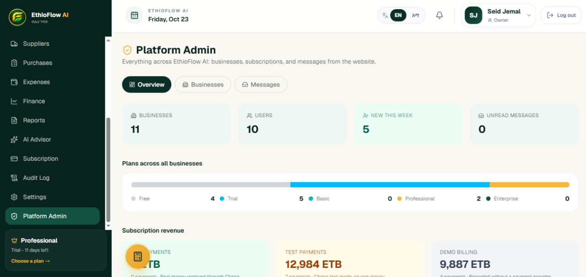
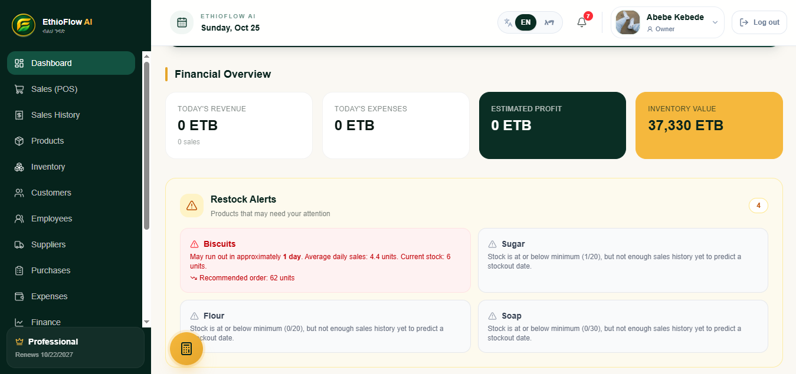
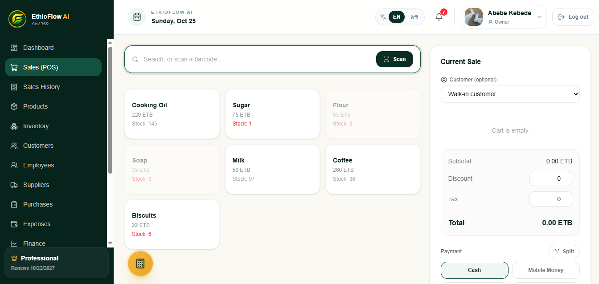
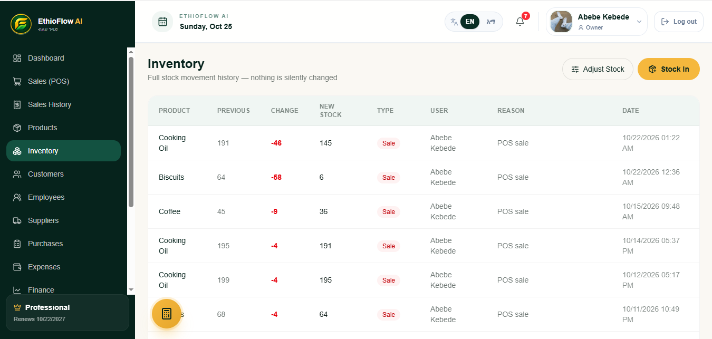
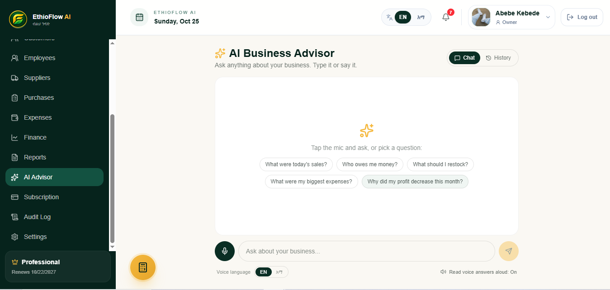
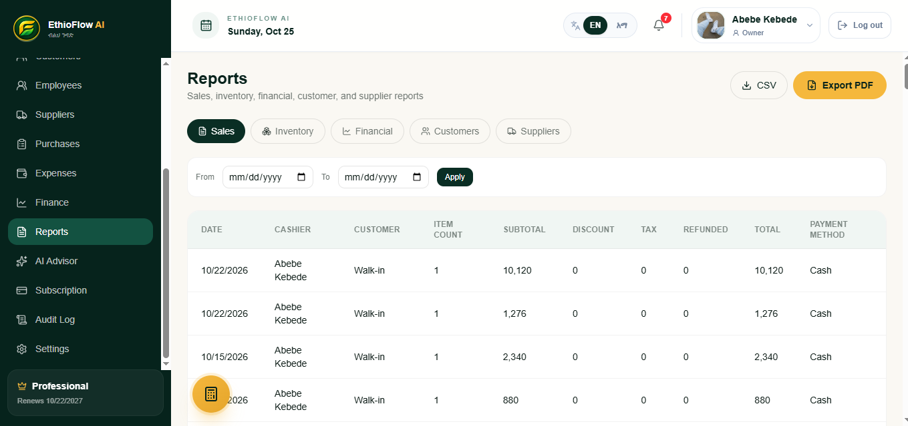
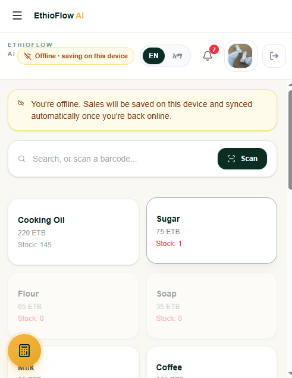
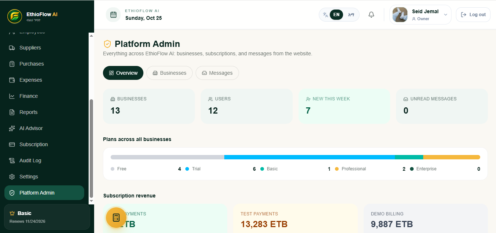
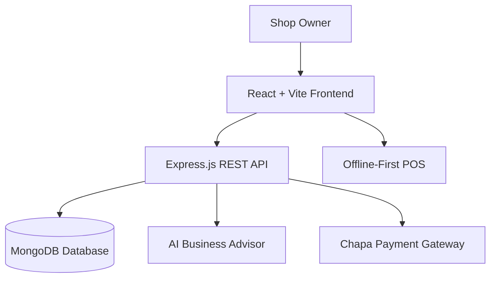
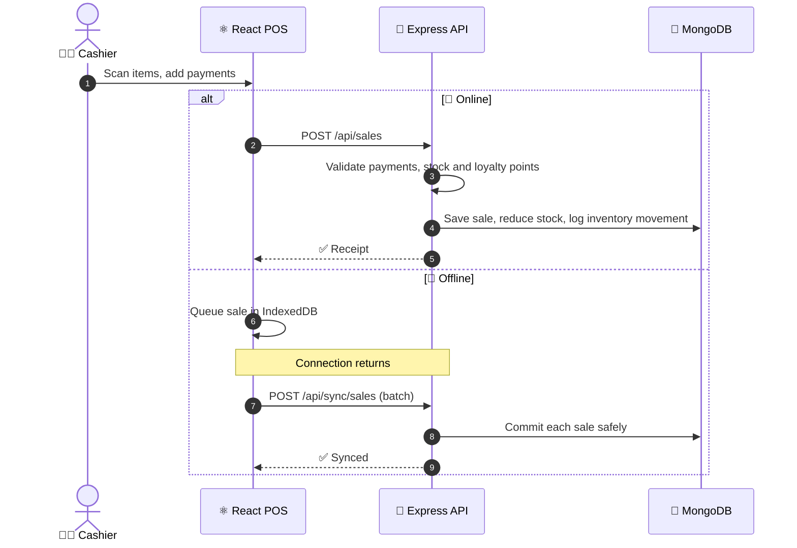

<!-- <div align="center">

# 🇪🇹 EthioFlow AI

### Smart Business Management for Ethiopian Businesses

A modern, full-stack business management platform designed to simplify business workflows with a clean interface, secure authentication, and intelligent digital tools.

Built with the MERN stack, EthioFlow AI aims to make business management simpler, smarter, and more accessible.


**🚀 Live Demo:** Coming Soon

**📡 Backend API:** Coming Soon

</div>

---

## ✨ Features

| Feature                     | Description                                                     |
| --------------------------- | --------------------------------------------------------------- |
| 🔐 **Authentication**       | Login, email verification, and password recovery                |
| 🏢 **Business Management**  | Business data models and backend infrastructure                 |
| 🛡️ **Admin Dashboard**      | Platform administration and contact message management          |
| 📩 **Contact System**       | Submit inquiries and receive email confirmations                |
| ✉️ **Email Communication**  | SMTP-based verification, recovery, and reply emails             |
| 🎨 **Modern UI**            | Responsive interface with forest-green, gold, and cream styling |
| 🔄 **API Integration**      | Centralized Axios configuration for frontend requests           |
| 🌐 **Internationalization** | i18next integration for localization support                    |
| 📊 **Data Visualization**   | Charting support with Recharts                                  |
| ⚠️ **Error Handling**       | Frontend error boundaries and backend error handling            |

---

## 🖥️ Preview

<div align="center">


_EthioFlow AI — Landing and Home Page_



_EthioFlow AI — Admin Dashboard_

</div>

---

## 🌐 Live Demo

| Service            | Link                                              |
| ------------------ | ------------------------------------------------- |
| 🌍 **Frontend**    | Coming Soon                                       |
| ⚙️ **Backend API** | Coming Soon                                       |
| 💻 **Source Code** | [GitHub Repository](https://github.com/Seid-Star) |

Deployment links will be added once the application is published.

---

## 🛠️ Tech Stack

### Frontend

- **React 19** — Component-based user interface
- **Vite 8** — Development server and production build
- **Tailwind CSS 4** — Responsive styling
- **React Router 7** — Client-side routing
- **Axios** — HTTP communication
- **Zustand** — State management
- **Recharts** — Data visualization
- **Lucide React** — Icon library
- **i18next** — Internationalization
- **GSAP** — Animations
- **jsPDF** — PDF generation
- **html5-qrcode** — QR code scanning
- **IndexedDB (idb)** — Client-side data storage support

### Backend

- **Node.js** — JavaScript runtime
- **Express 5** — REST API framework
- **MongoDB** — NoSQL database
- **Mongoose 9** — Database modeling
- **JWT** — Token-based authentication
- **bcryptjs** — Password hashing
- **Nodemailer** — Email delivery
- **Express Validator** — Request validation
- **Helmet** — Security headers
- **Express Rate Limit** — Request rate limiting
- **Multer** — File upload handling
- **Google GenAI SDK** — Generative AI integration
- **Cookie Parser** — Cookie parsing
- **CORS** — Cross-origin request configuration
- **Morgan** — HTTP request logging

### Development Tools

- **Git & GitHub** — Version control
- **npm** — Package management
- **Nodemon** — Automatic backend restarts
- **ESLint** — Code quality and linting

---

## 📁 Project Structure

```text
ethioflow-ai/
├── client/
│   ├── public/
│   ├── src/
│   │   ├── api/
│   │   ├── components/
│   │   │   ├── admin/
│   │   │   ├── auth/
│   │   │   ├── landing/
│   │   │   └── layout/
│   │   ├── lib/
│   │   ├── pages/
│   │   ├── App.jsx
│   │   └── main.jsx
│   ├── package.json
│   └── vite.config.js
│
├── server/
│   ├── src/
│   │   ├── config/
│   │   ├── controllers/
│   │   ├── middleware/
│   │   ├── models/
│   │   ├── routes/
│   │   ├── services/
│   │   ├── utils/
│   │   ├── app.js
│   │   └── server.js
│   ├── .env.example
│   └── package.json
│
├── screenshots/
│   ├── landing-page.png
│   └── admin-dashboard.png
│
├── .gitignore
└── README.md
```

---

## 🏗️ Architecture

EthioFlow AI follows a client-server architecture.

- **Frontend:** React provides the user interface and communicates with the backend through Axios.
- **Backend:** Express handles API requests, authentication, validation, and business logic.
- **Database:** MongoDB stores application data through Mongoose models.
- **Authentication:** JWT-based authentication and protected administrative routes.
- **Email Service:** Nodemailer supports verification, password recovery, and contact replies through SMTP.
- **AI Integration:** The backend includes the Google GenAI SDK for generative AI functionality.

---

## ☁️ Deployment

EthioFlow AI is being prepared for production deployment.

| Component      | Deployment URL                                |
| -------------- | --------------------------------------------- |
| 🌍 Frontend    | _Coming Soon_                                 |
| ⚙️ Backend API | _Coming Soon_                                 |
| 🗄️ Database    | MongoDB Atlas or configured database provider |

### Production Checklist

- [ ] Deploy the frontend.
- [ ] Deploy the backend API.
- [ ] Configure production environment variables.
- [ ] Connect the production database.
- [ ] Configure the frontend API URL.
- [ ] Configure CORS for the deployed frontend.
- [ ] Configure SMTP email delivery.
- [ ] Test registration, login, and email verification.
- [ ] Test password recovery.
- [ ] Test contact submissions and administrative replies.
- [ ] Verify HTTPS and security configuration.
- [ ] Add live links and screenshots to this README.

---

## 🛣️ Roadmap

- [ ] Complete production deployment.
- [ ] Publish the live frontend and API URLs.
- [ ] Add real application screenshots.
- [ ] Expand business management capabilities.
- [ ] Improve analytics and reporting.
- [ ] Expand localization for Ethiopian users.
- [ ] Add automated testing and continuous integration.
- [ ] Improve production monitoring and error tracking.

---

## 🔒 Security

EthioFlow AI incorporates security-related technologies and practices, including:

- Password hashing with bcryptjs.
- JWT-based authentication.
- Protected administrative endpoints.
- Request validation and rate limiting.
- Security headers through Helmet.
- Environment-based configuration for secrets.

**Important security practices:**

- Never commit real `.env` files.
- Never expose SMTP app passwords or database credentials.
- Never publish JWT secrets or private API keys.
- Use strong production secrets.
- Configure CORS for trusted origins.
- Review authentication and authorization before deployment.

---

## 🧪 Development Scripts

### Frontend

Run these commands from the `client/` directory.

| Command           | Description                          |
| ----------------- | ------------------------------------ |
| `npm run dev`     | Start the Vite development server    |
| `npm run build`   | Build the frontend for production    |
| `npm run lint`    | Run ESLint                           |
| `npm run preview` | Preview the production build locally |

### Backend

Run these commands from the `server/` directory.

| Command        | Description                              |
| -------------- | ---------------------------------------- |
| `npm run dev`  | Start the backend with Nodemon           |
| `npm start`    | Start the backend with Node.js           |
| `npm run seed` | Run the configured demo-data seed script |

---

## 🤝 Contributing

Contributions, suggestions, and bug reports are welcome.

1. Fork the repository.
2. Create a feature branch.
3. Implement your changes.
4. Test the affected functionality.
5. Commit your changes with a descriptive message.
6. Open a pull request describing your contribution.

Please ensure that your changes do not introduce credentials, break existing functionality, or expose sensitive application data.

---

## 📬 Contact

<div align="center">

### Seid Jemal

**Software Engineering Student | Full-Stack Developer**

📧 **Email:** [sjrd02911@gmail.com](mailto:sjrd02911@gmail.com)

💻 **GitHub:** [Seid-Star](https://github.com/Seid-Star)

🔗 **LinkedIn:** [Seid Jemal](https://linkedin.com/in/seid-jemal-6267a5421)

</div>

---

## 📄 License

The backend package specifies the ISC license. Confirm the intended license for the complete project and add a root-level `LICENSE` file before distributing it publicly.

<div align="center">

### EthioFlow AI

**Smarter workflows. Better business.**

Made with dedication in Ethiopia 🇪🇹

</div> -->

<div align="center">


<br>

[](https://ethioflow-ai.onrender.com/)

<sub>🟢 Live now at <a href="https://ethioflow-ai.onrender.com/">ethioflow-ai.onrender.com</a> &nbsp;•&nbsp; first load may take ~30s while the free server wakes up</sub>

<br>


[](https://ethioflow-ai.onrender.com/)

[](https://github.com/Seid-Star/ethioflow-ai/stargazers)
[](https://github.com/Seid-Star/ethioflow-ai/network/members)
[](https://github.com/Seid-Star/ethioflow-ai/commits/main)


<br>

**[🚀 Live Demo](https://ethioflow-ai.onrender.com/)** &nbsp;•&nbsp;
**[📸 Screenshots](#-screenshots)** &nbsp;•&nbsp;
**[✨ Features](#-features)** &nbsp;•&nbsp;
**[🏗️ Architecture](#%EF%B8%8F-architecture)** &nbsp;•&nbsp;
**[💳 Plans](#-plans--pricing)** &nbsp;•&nbsp;
**[⚡ Quick Start](#-quick-start)** &nbsp;•&nbsp;
**[👤 Author](#-meet-the-author)**


</div>

## 🌍 Why EthioFlow AI?

Most business software is built for somewhere else. It assumes always-on internet, dollar pricing and English-only staff.

**EthioFlow AI is built for how Ethiopian shops, pharmacies, cafés and wholesalers actually run.**

> 🛒 **Sell** at the counter, even when the network drops &nbsp;→&nbsp; 📦 **Track** every unit in and out &nbsp;→&nbsp; 👥 **Manage** staff, suppliers and customers &nbsp;→&nbsp; 🤖 **Ask** an AI advisor what your numbers mean.

Everything is priced in **ETB**, available in **English and Amharic**, and designed to keep working when connectivity doesn't.

<div align="center">


</div>

<br>

## 📸 Screenshots

<div align="center">

### ✨ First Impression


<sub>**Home** — “Grow smarter. Flow better.”</sub>

<br><br>


<sub>**Landing page** — interactive 3D feature carousel</sub>

<br><br>

### 📊 Inside the App

<table>
<tr>
<td align="center" width="50%">
<br>
<b>📊 Business Dashboard</b><br><sub>Revenue, profit and trends at a glance</sub>
</td>
<td align="center" width="50%">
<br>
<b>🧾 POS Terminal</b><br><sub>Barcode scan, split payments, receipts</sub>
</td>
</tr>
<tr>
<td align="center" width="50%">
<br>
<b>📦 Inventory &amp; Stock</b><br><sub>Every movement tracked and auditable</sub>
</td>
<td align="center" width="50%">
<br>
<b>🤖 AI Business Advisor</b><br><sub>Ask questions about your own data</sub>
</td>
</tr>
<tr>
<td align="center" width="50%">
<br>
<b>📈 Reports &amp; Finance</b><br><sub>Charts and exportable PDF reports</sub>
</td>
<td align="center" width="50%">
<br>
<b>📱 Mobile &amp; Offline Mode</b><br><sub>Keep selling with no connection</sub>
</td>
</tr>
</table>

### 🛡️ Platform Administration



<sub>**Admin dashboard** — businesses, subscriptions and customer messages</sub>

</div>

<br>

<div align="center">

  

</div>

## ✨ Features

<table>
<tr>
<td width="50%" valign="top">

### 🧾 Point of Sale

- Fast cart with **barcode scanning** (camera-based)
- **Split payments** across several methods in one sale
- **Customer credit** and loyalty-point redemption
- Built-in **calculator**: basic, pricing, tax and change modes
- 🎙️ Voice input support
- Printable / PDF receipts

</td>
<td width="50%" valign="top">

### 📦 Inventory &amp; Purchasing

- Live stock with **out-of-stock protection** at checkout
- Full **inventory movement history** for every change
- Suppliers and purchase orders
- 🧠 **Receipt OCR** reads supplier receipts with AI

</td>
</tr>
<tr>
<td width="50%" valign="top">

### 🤖 AI Advisor (Google Gemini)

- Conversational advisor with saved message history
- Insights from **your real sales, expenses and profit**
- Receipt scanning to cut manual data entry

</td>
<td width="50%" valign="top">

### 📶 Offline-First

- Sales are queued in **IndexedDB** when the network drops
- A sync manager commits them safely when you reconnect
- Each offline sale carries a unique transaction ID to avoid duplicates

</td>
</tr>
<tr>
<td width="50%" valign="top">

### 👥 People &amp; Customers

- Employee records, **attendance** and **leave requests**
- Customer profiles, purchase history and credit
- **Loyalty program**: earn 1 point per 10 ETB, redeem each point for 0.5 ETB

</td>
<td width="50%" valign="top">

### 💰 Finance &amp; Reports

- Expense tracking and finance overview
- Refund management
- Interactive **Recharts** analytics
- Export reports to **PDF** (jsPDF)

</td>
</tr>
<tr>
<td width="50%" valign="top">

### 🔐 Security &amp; Trust

- JWT access + refresh tokens, bcrypt password hashing
- Email verification and password recovery
- Helmet headers, rate limiting, request validation
- **Audit trail** across auth, sales, inventory, staff and billing

</td>
<td width="50%" valign="top">

### 🌐 Built for Ethiopia

- **English 🇬🇧 + Amharic 🇪🇹** via i18next
- Prices in **ETB** everywhere
- **Chapa** payments for subscriptions
- Plan-based feature gating and 14-day trial

</td>
</tr>
</table>

<br>

## 🏗️ Architecture

<div align="center">



</div>

<br>

**What happens when a cashier completes a sale:**



<br>

## 💳 Plans &amp; Pricing

Every new business starts with a **14-day trial**. Prices are in Ethiopian Birr.

<div align="center">

|              | 🌱 **Free** | 🚀 **Basic**  | 💼 **Professional** | 🏢 **Enterprise** |
| :----------- | :---------: | :-----------: | :-----------------: | :---------------: |
| **Monthly**  |    0 ETB    |  **299** ETB  |     **799** ETB     |   **1,999** ETB   |
| **Yearly**   |    0 ETB    | **2,990** ETB |    **7,990** ETB    |  **19,990** ETB   |
| **Products** |  up to 25   |   up to 250   |    ♾️ Unlimited     |   ♾️ Unlimited    |

</div>

<br>

## 🛠️ Tech Stack

<details>
<summary><b>🎨 Frontend</b> &nbsp;— click to expand</summary>

<br>

| Tech                           | Purpose                  |
| :----------------------------- | :----------------------- |
| **React 19**                   | UI components            |
| **Vite 8**                     | Dev server and build     |
| **Tailwind CSS 4** + shadcn/ui | Styling and components   |
| **React Router 7**             | Routing                  |
| **Zustand**                    | State management         |
| **Axios**                      | API client               |
| **Recharts**                   | Analytics charts         |
| **GSAP**                       | Animations               |
| **i18next**                    | English / Amharic        |
| **idb (IndexedDB)**            | Offline sales queue      |
| **html5-qrcode**               | Barcode / QR scanning    |
| **jsPDF + AutoTable**          | PDF receipts and reports |
| **qrcode.react**               | QR code generation       |
| **Lucide**                     | Icons                    |

</details>

<details>
<summary><b>⚙️ Backend</b> &nbsp;— click to expand</summary>

<br>

| Tech                                | Purpose                    |
| :---------------------------------- | :------------------------- |
| **Node.js 20+ / Express 5**         | REST API                   |
| **MongoDB / Mongoose 9**            | Database and models        |
| **JWT + bcryptjs**                  | Authentication             |
| **Google GenAI SDK**                | AI advisor and receipt OCR |
| **Nodemailer / Brevo**              | Transactional email        |
| **Chapa**                           | Subscription payments      |
| **Helmet · Rate limit · Validator** | Security hardening         |
| **Multer**                          | File uploads               |
| **Compression · Morgan · CORS**     | Performance and logging    |

</details>

<details>
<summary><b>📁 Project structure</b> &nbsp;— click to expand</summary>

```text
ethioflow-ai/
├── client/                     # React + Vite front end
│   └── src/
│       ├── api/                # Axios instance and interceptors
│       ├── components/         # admin, auth, billing, calculator, landing, layout, ui
│       ├── i18n/               # en.json, am.json
│       ├── lib/                # birr, receipt, loyalty, calcEngine, useVoice...
│       ├── pages/              # POS, Inventory, Dashboard, AIAdvisor, Finance...
│       └── store/              # Zustand stores (auth, cart)
├── server/                     # Express API
│   └── src/
│       ├── config/             # plans, loyalty, audit rules, db
│       ├── controllers/        # 20 feature controllers
│       ├── middleware/         # auth, planGate, auditTrail, validation
│       ├── models/             # 18 Mongoose models
│       ├── routes/
│       └── services/
└── screenshots/
```

</details>

<br>

## ⚡ Quick Start

> 🚀 **Just want to look around?** Skip the setup and open the **[live demo](https://ethioflow-ai.onrender.com/)**.

**Prerequisites:** Node.js 20+ and a MongoDB database (local or Atlas).

```bash
# 1. Clone
git clone https://github.com/Seid-Star/ethioflow-ai.git
cd ethioflow-ai

# 2. Start the API
cd server
cp .env.example .env        # then fill in your values
npm install
npm run seed                # optional: load demo data
npm run dev                 # → http://localhost:5000 (or your PORT)

# 3. Start the client (new terminal)
cd client
npm install
npm run dev                 # → http://localhost:5173
```

<details>
<summary><b>🔑 Environment variables</b> &nbsp;— click to expand</summary>

<br>

| Variable                                    | What it's for                                   |
| :------------------------------------------ | :---------------------------------------------- |
| `MONGO_URI`                                 | MongoDB connection string                       |
| `JWT_SECRET` · `JWT_REFRESH_SECRET`         | Token signing secrets (use long random values)  |
| `CLIENT_URL`                                | Front-end origin, used for CORS and email links |
| `GEMINI_API_KEY`                            | Google Gemini (AI advisor and OCR)              |
| `CHAPA_SECRET_KEY` · `CHAPA_WEBHOOK_SECRET` | Chapa subscription payments                     |
| `BREVO_API_KEY` or `SMTP_*`                 | Email delivery                                  |
| `CONTACT_INBOX`                             | Where contact-form messages arrive              |

> 🔒 Never commit your real `.env` file.

</details>

<br>

## 🛣️ Roadmap

- [x] Authentication with email verification and password recovery
- [x] POS with split payments, loyalty and customer credit
- [x] Inventory, purchases, suppliers and expenses
- [x] AI advisor and receipt OCR
- [x] Offline sales queue with batch sync
- [x] Subscription plans with Chapa
- [x] English and Amharic
- [x] 🚀 Public live demo deployment on Render
- [ ] 🧪 Automated tests and CI pipeline
- [ ] 📊 Deeper analytics and forecasting
- [ ] 🔔 Production monitoring and error tracking
- [ ] 🌍 More Ethiopian languages (Afaan Oromoo, Tigrinya)

<br>

## 🤝 Contributing

Ideas, bug reports and pull requests are welcome.

1. 🍴 Fork the repo
2. 🌿 Create a branch: `git checkout -b feature/amazing-idea`
3. 💾 Commit with a clear message
4. 📬 Open a pull request

<br>

<div align="center"></div>

## 👤 Meet the Author

<div align="center">

<!-- 📸 YOUR PHOTO: run  python tools/make_avatar.py path/to/your-photo.jpg  → replaces assets/avatar.svg -->


# Seid Jemal

**Software Engineering Student &nbsp;•&nbsp; Full-Stack Developer**

_I build practical software for real businesses, starting with the ones around me in Ethiopia 🇪🇹_

<br>

[](mailto:sjrd02911@gmail.com)
[](https://linkedin.com/in/seid-jemal-6267a5421)
[](https://github.com/Seid-Star)

<br>

**💬 Want to collaborate, give feedback or just say hi? My inbox is open.**

<br>

⭐ **If EthioFlow AI helped or inspired you, please give it a star. It means a lot!** ⭐

<br>


**EthioFlow AI** — _Grow smarter. Flow better._

<sub>Made with ☕, late nights and dedication in Ethiopia 🇪🇹</sub>

</div>
